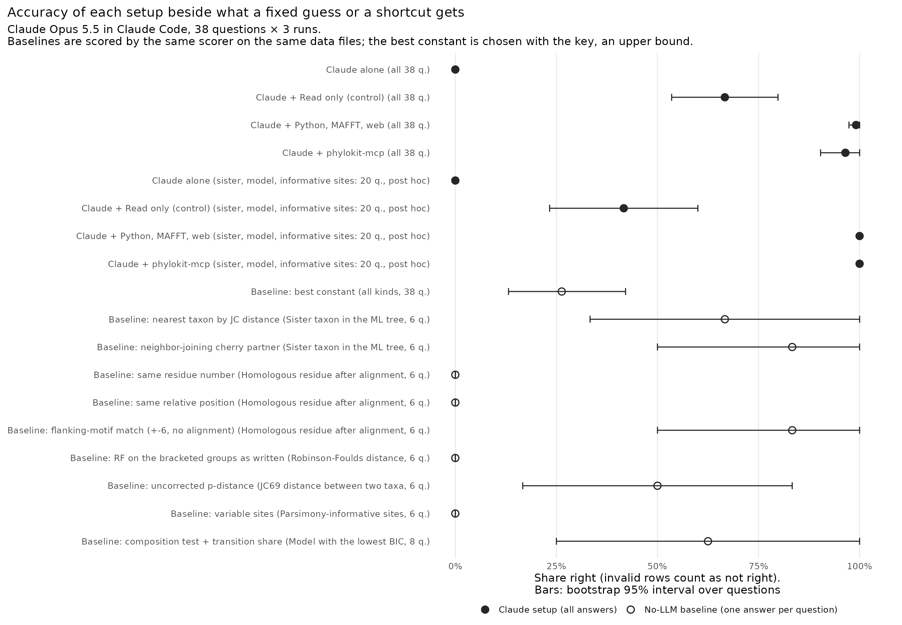

# Agent benchmark: phylogenetics questions with and without the server

We asked Claude Opus 5.5 38 phylogenetics questions, 3 times each, with no
tools, with Read only, with a Python shell that has the server's own engine
(piqtree, MAFFT), and with phylokit-mcp. The server did not make Claude more
accurate than the Python shell: 36 of 38 questions right in every run against
37 of 38, with 2 questions favoring Python and 1 the server (exact sign test
p = 1). The server was slower and cost more: per question it took 6.0 times as
long (95% CI 4.4 to 8.3) and cost 14.4 times as much (9.9 to 20.2). The main
limitation is that half the kinds of question can be solved by reading the
file: the Read-only control got 21 of 38 right in every run.


## Results

| Setup | Right | Wrong | Declined | Invalid | Questions right in all 3 runs | Cost / answer, median (mean) | Seconds / answer, median (mean) |
|---|---|---|---|---|---|---|---|
| Claude alone | 0 | 0 | 114 | 0 | 0 of 38 | $0.012 ($0.012) | 5.4 (5.8) |
| Claude + Read only (control) | 76 | 24 | 12 | 2 | 21 of 38 | $0.18 ($0.27) | 34.5 (79.2) |
| Claude + Python, MAFFT, web | 113 | 0 | 0 | 1 | 37 of 38 | $0.029 ($0.030) | 13.3 (15.6) |
| Claude + phylokit-mcp | 110 | 4 | 0 | 0 | 36 of 38 | $0.55 ($0.55) | 112.2 (133.7) |
| Best constant per kind, fit to the key, no model | 10 | 28 | 0 | 0 | 10 of 38 | – | – |
| Nearest taxon by JC distance, no model (sister, 6 q.) | 4 | 2 | 0 | 0 | 4 of 6 | – | – |
| Neighbor-joining cherry partner, no model (sister, 6 q.) | 5 | 1 | 0 | 0 | 5 of 6 | – | – |
| RF on the bracketed groups as written, no model (RF, 6 q.) | 0 | 6 | 0 | 0 | 0 of 6 | – | – |
| Same residue number, no model (homology, 6 q.) | 0 | 6 | 0 | 0 | 0 of 6 | – | – |
| Same relative position, no model (homology, 6 q.) | 0 | 6 | 0 | 0 | 0 of 6 | – | – |
| Flanking-motif match (±6, no alignment), no model (homology, 6 q.) | 5 | 1 | 0 | 0 | 5 of 6 | – | – |
| Composition test + transition share, no model (model, 8 q.) | 5 | 3 | 0 | 0 | 5 of 8 | – | – |
| Uncorrected p-distance, no model (distance, 6 q.) | 3 | 3 | 0 | 0 | 3 of 6 | – | – |
| Variable sites, no model (informative sites, 6 q.) | 0 | 6 | 0 | 0 | 0 of 6 | – | – |

Claude rows are out of 114 answers; each no-model baseline answers each of
its questions once. A question's three runs are not independent, so the
questions column is the fairer count. An invalid row counts as not right,
whatever its reply scored. The numbers come from [`summary.tsv`](summary.tsv)
and [`paired.tsv`](paired.tsv), which `analyze.py` writes from
[`results.jsonl`](results.jsonl) and [`results_read.jsonl`](results_read.jsonl).
Intervals are 95% bootstrap intervals over questions. Time and cost ratios
are the geometric mean, over questions, of the ratio of the two setups'
per-question medians.

- Accuracy over answers was 0.965 (95% CI 0.90 to 1.00) with the server and
  0.991 (0.97 to 1.00) with Python.
- The server was slower on 36 of 38 questions (sign test p = 5e-9).
- Both tool setups beat Read only: 37 and 36 of 38 questions right in every
  run against 21. The discordant questions split 16:0 for Python (p = 3e-5)
  and 16:1 for the server (p = 3e-4).
- The server's 4 wrong answers are all homology (q13 three times, q14 once),
  and all are counting slips after the alignment. `align_sequences` returns
  the alignment, and the model then counted residues along the aligned rows
  by hand, as each reply says: 337, 339 and 337 against a key of 338, and 356
  against 366. The server has no tool that maps a residue to its column, so
  this step is left to the model.
- The slowest single answers took 11 s (alone), 1,688 s (Read only), 43 s
  (Python) and 663 s (server).




## Controls

`controls.py` and `run.py` hold these. Tests: `tests/test_agent_qa_score.py`,
`tests/test_agent_qa_controls.py`.

- Oracle: before any run, `run.py` stops unless every key answer scores right
  and a known-wrong answer to every question scores wrong (another taxon,
  RF + 2, sites + 1, position + 1, the next model, a distance outside the
  tolerance). On the real key, 38 of 38 scored right and 38 of 38 wrong.
- Baselines: the best constant per kind, chosen with the key, which is an
  upper bound on any constant; and one shortcut per kind that a reader
  without tools could take. They are in the table above and in
  [`baselines.tsv`](baselines.tsv).
- Validity: one rule for every setup (`run.py`'s `validity`). A run counts
  only if it exited 0 with a result, its tools were exactly the setup's, a
  setup with tools made at least one call, no setup other than the server's
  named `phylokit` in a tool input, and the leak scan found nothing. Invalid
  rows are kept, never retried, and count as not right. Invalid: 0 alone,
  2 Read only, 1 Python, 0 server.
- Leak scan: every tool input and output in all 456 transcripts is searched
  for the key and the benchmark's code by name, its transcripts and
  artifacts, the repo's worktrees, its directory on GitHub, and another
  run's directory. Hits: 3 rows, the 3 invalid ones. Python's (q10, run 2)
  printed a traceback naming the alt environment's path, then inside the
  benchmark directory; its answer was right. The 2 Read rows (q01 and q02,
  run 1) were a harness fault: the first launch put run directories under a
  path naming the server and the benchmark, so every Read of the data file
  tripped both the leak scan and the "named phylokit" rule. We stopped that
  launch and restarted it in the system temp dir. The two rows cost Read
  only one right answer (q02); over valid rows alone it scores 0.679.

## Limitations

Half the kinds of question are solvable by reading. Version 2 was built so
that the inputs would be past what can be worked by eye. The Read-only
control shows that this held for three kinds and not for the other three:

| Kind | Read only: right / 18 (24 for model) | Questions right in all 3 runs | How it got there (from its replies) |
|---|---|---|---|
| JC69 distance | 18 | 6 of 6 | counted differences in blocks of 10, applied the JC69 formula |
| RF distance | 17 | 5 of 6 | listed every split of both trees by hand |
| Homologous residue | 16 | 4 of 6 | matched the flanking motif in the other sequence, no alignment |
| Sister taxon | 11 (2 invalid) | 3 of 6 | |
| Model with lowest BIC | 11 | 3 of 8 | base composition plus a transition share counted on a sample |
| Parsimony-informative sites | 3 (12 declined) | 0 of 6 | |

On distance, RF and homology, Claude with only Read gets almost every answer,
so those 18 questions cannot show a difference between a tool and no tool.
The baselines agree: the flanking-motif match gets 5 of 6 homology
questions, because the no-gap margin that makes the key certain also makes
the residue findable by its context, and the distance tolerance (3 SDs of
the estimate) admits a careful hand count.

On the other three kinds we looked again at 20 questions. This subset was
chosen after the Read control ran, so it is post hoc:

| Setup (post hoc subset) | Right / 60 | 95% CI | Questions right in all 3 runs |
|---|---|---|---|
| Claude alone | 0 | 0.00 to 0.00 | 0 of 20 |
| Claude + Read only | 25 | 0.23 to 0.60 | 6 of 20 |
| Claude + Python, MAFFT, web | 60 | 1.00 to 1.00 | 20 of 20 |
| Claude + phylokit-mcp | 60 | 1.00 to 1.00 | 20 of 20 |

On this post hoc subset both tool setups beat reading (14:0 discordant
questions for each, p = 1.2e-4), and the server and Python still tie. The
server took 11.9 times as long (95% CI 8.9 to 15.6) and cost 32 times as much
(27 to 39) as Python.

Other limitations:

- The data are simulated. Trees are drawn at random and sequences evolved
  down them under JC69 or the HKY85 family, with indels added for the
  alignment questions. Real alignments have rate variation, compositional
  shifts and alignment error that none of these questions contain.
- The questions are answerable on purpose. A draw was kept only when
  piqtree's ML tree contained the asked cherry (sister), MAFFT put the asked
  residue in the true column (homology), the generating model won BIC by at
  least 2 (model choice), and both distance estimates fell in the tolerance
  (distances). Cases where the data do not support the answer are not
  tested, and those are where the server's bootstrap support matters most.
- Support values are not scored. No question asks how well supported a
  clade is.
- The server takes the alignment as a string, so the model has to read the
  file and copy its contents into the tool call. The largest file here is
  20 KB, and copying it costs output tokens. Much larger alignments would
  need a path argument.
- One model, one date.

## Method

### Setups

Each run is a separate `claude -p` with Claude Opus 5.5:

- Claude alone: no tools. The data are in a file it cannot open, so the
  right reply is `UNKNOWN`. It is the floor.
- Claude + Read only (control): it can see every byte of the data file and
  has nothing to compute with (no shell, server or web). It tests whether the
  questions need computation at all.
- Claude + Python, MAFFT, web: what a user has without this server. Bash,
  Read, WebSearch and WebFetch, a Python with piqtree, cogent3 and numpy but
  not the server, and MAFFT on `PATH`. Its prompt says these are installed.
- Claude + phylokit-mcp: the server plus Read, with MAFFT on `PATH`. It needs
  Read because the server takes sequences as a string.

The comparison that matters is the Python shell against the server: the same
engine driven from a shell or through the server. Every run gets `--setting-sources ""`,
`--strict-mcp-config` (no other MCP servers), the same short system prompt,
and an empty working directory in the system temp dir holding only the
question's data file. The user prompts are the same apart from the Python
setup's one-sentence note on what its shell has.

### Questions

[`questions.json`](questions.json) holds the 38 questions and their answers
(version 2, seed 20261016, built by `build_questions.py`). Each question's
data is written as a file (`alignment.fasta`, `sequences.fasta` or
`trees.nwk`) into the run's working directory, and the prompt names the file.

| Kind | Count | Server tool it exercises | Answer key |
|---|---|---|---|
| Sister taxon in the ML tree (24 taxa, 800 sites, JC69, internal edges 0.01-0.05) | 6 | `infer_tree` | the asked taxon's cherry partner in the generating tree |
| Robinson-Foulds distance (30-50 tips, 3-30 NNI moves apart) | 6 | `compare_trees` | splits of the two Newick strings as written, symmetric difference |
| Homologous residue after alignment (10 seqs, 3 DNA + 3 protein, indel-rich) | 6 | `align_sequences` | the true alignment from an indel simulator that tracks every residue's column |
| Model with the lowest BIC among JC69, K80, F81, HKY85 (16 taxa, 1200 sites) | 8 | `select_substitution_model` | the generating model, 2 per model |
| JC69 distance between two taxa (16 taxa, 1000 sites) | 6 | `infer_tree` (branch lengths) | path length between the two tips in the generating tree |
| Parsimony-informative sites (16-24 taxa, 800-1000 sites) | 6 | `infer_tree`, `align_sequences` (`n_parsimony_informative`) | counted from the alignment |

The key comes from [`truth.py`](truth.py), which uses numpy and plain Python
and never imports `phylokit_mcp`, cogent3 or piqtree, so a bug in the server
or the libraries under it cannot also be in the key
(`tests/test_agent_qa_score.py` checks the imports). piqtree and MAFFT are
used only to check that a draw is answerable. 2 of 8 homology draws were
discarded because MAFFT disagreed with the true column; no other draw was
discarded (`questions.json` records the draws). In 2 of the 6 sister
questions, the taxon nearest the asked one by JC distance is not its sister,
so the answer needs a tree. Rebuilding gives the same questions and answers.

### Scoring

Each reply ends with `ANSWER: <value>` or `ANSWER: UNKNOWN`, and `score.py`
reads only that line: right, wrong, declined (`UNKNOWN`) or no answer.
Sister taxa match by name, case ignored. RF distances, informative-site
counts and homologous residues must be the exact integer ("0.6" is not read
as 6); neither sequence has a gap within 6 columns of the asked residue. A
model matches by any of its names: IQ-TREE writes HKY85 as `HKY+F` and F81 as
`F81+F`, and `K2P+F` is HKY85. A distance is right within 3 large-sample SDs
of the JC69 estimate at the true distance, sd = sqrt(p(1-p)/n) / (1 - 4p/3),
because an estimate from data differs from the generating value by sampling
error; the best constant is right on 3 of 6.

A wrong answer that is still a legitimate option (a taxon in the alignment,
one of the four models) is also flagged `wrong_id`. Each row also records
whether any tool call named `phylokit` or the key file (`mentions_phylokit`,
`mentions_key`).

### Versions

phylokit-mcp 0.6.0 from PyPI. The Python setup and the server use the same
locked libraries (the repo's `uv.lock`): piqtree 0.8.3 (IQ-TREE 3), cogent3
2026.7.30a0 and numpy 2.4.6. MAFFT v7.526. Claude Code 2.1.302, model
`claude-opus-5-5`. The three main setups ran on 2026-10-16 and the Read-only
control on 2026-10-16 and 17, US Eastern. The key's build date in
`questions.json`, 2026-10-17, is UTC, which was the evening of 10-16 Eastern.

Raw transcripts are kept in `~/phylokit-mcp-artifacts/agent_qa/runs/` (or
`$PHYLOQA_ARTIFACTS`), outside the repo.

## History

1. Version 1 put 6- to 8-taxon data in the prompt. In a partial sweep (87 of
   414 runs), Claude with no tools got 28 of 30 right, including every sister
   taxon, RF and homologous-residue question, so the sweep said nothing about
   the server. The partial rows are in
   [`history/v1_partial_results.jsonl`](history/v1_partial_results.jsonl).
2. Version 2 scaled the inputs (16-24 taxa and 800-1200 sites, 30-50-tip
   trees, ten indel-rich sequences of 300-700 residues) and gives them as
   files only. A test checks that no question carries its data in the prompt.
3. Controls were added during the version 2 sweep, and its runs were
   rescored under them: oracle, baselines, one validity rule, leak scan,
   bootstrap intervals and paired tests, and the Read-only control arm.
4. The Read control's first launch tripped the leak rule (see Controls). Run
   directories moved to the system temp dir, and `check_run_dir` now refuses
   a path that names the server or the benchmark. `analyze.py` and `plot.R`
   now take several results files and refuse a run found twice.
5. The Read-only results and the post hoc subset (PR #62) showed that the
   scaling was enough for three kinds and not for RF, distance and homology.

## Reproduce

```bash
export MAFFT=/path/to/mafft                                 # if MAFFT is not on PATH
uv run python benchmarks/agent_qa/build_questions.py        # rebuild the key (writes questions.json)
uv run python benchmarks/agent_qa/run.py --setup-alt        # once: the alt arm's Python, without the server
uv run python benchmarks/agent_qa/run.py --reps 3 --workers 2   # 342 claude -p runs; resumable
uv run python benchmarks/agent_qa/run.py --arms read --reps 3 --workers 1 \
    --results benchmarks/agent_qa/results_read.jsonl        # the Read-only control, 114 runs
uv run python benchmarks/agent_qa/run.py --rescore          # re-score stored replies (add --results for the read file)
R=benchmarks/agent_qa/results.jsonl,benchmarks/agent_qa/results_read.jsonl
uv run python benchmarks/agent_qa/analyze.py $R             # summary.tsv, paired.tsv, baselines.tsv
Rscript benchmarks/agent_qa/plot.R $R                       # figures
```
