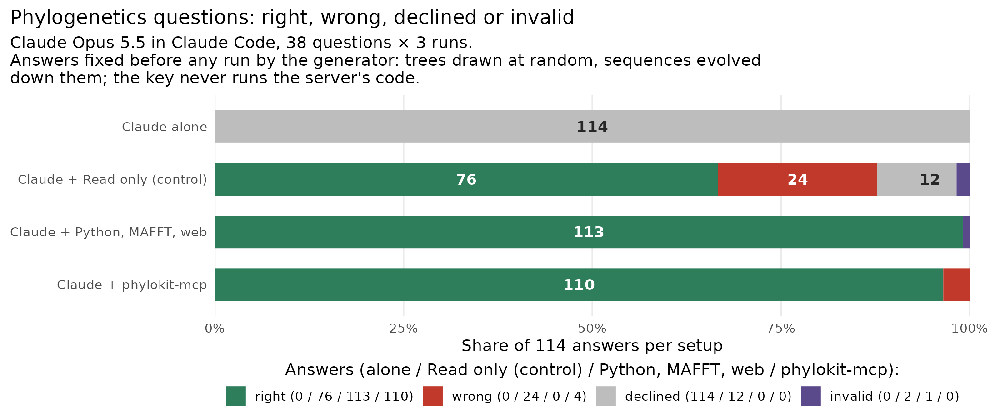
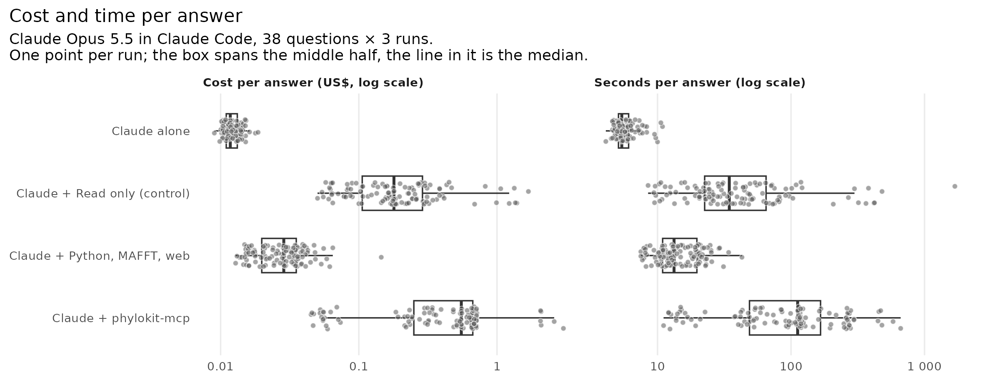
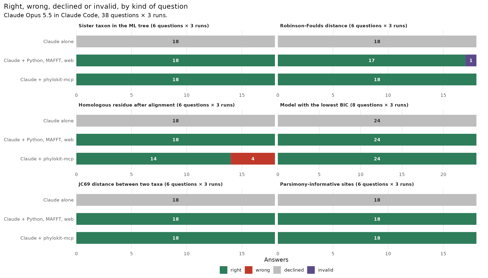

# Agent benchmark: phylogenetics questions with and without the server

Does Claude answer phylogenetics questions better with phylokit-mcp than
without it? 38 questions, asked 3 times each to Claude Opus 5.5 in Claude Code
under three setups:

- **Claude alone**: no tools. The data are in a file it cannot open, so the
  right reply is `UNKNOWN`. It is the floor, not a competitor.
- **Claude + Python, MAFFT, web**: what a user has without this server. Bash,
  Read, WebSearch and WebFetch, a Python with piqtree (IQ-TREE 3), cogent3 and
  numpy (the server's own locked versions, but not the server), and MAFFT on
  `PATH`. Its prompt says these are installed.
- **Claude + phylokit-mcp**: this server (0.6.0 from PyPI) plus Read, with
  MAFFT on `PATH`. It needs Read because the server takes sequences as a
  string, not a file path.

The comparison that matters is the second against the third: the same engine
(IQ-TREE 3 through piqtree, MAFFT) driven by Claude from a shell, or through
the server.

TODO: run date and Claude Code version (the full sweep has not run yet).



| Setup | Right | Wrong | Declined | Questions right in all 3 runs | Cost / answer, median (mean) | Seconds / answer, median (mean) | Slowest |
|---|---|---|---|---|---|---|---|
| Claude alone | TODO | TODO | TODO | TODO of 38 | TODO | TODO | TODO |
| Claude + Python, MAFFT, web | TODO | TODO | TODO | TODO of 38 | TODO | TODO | TODO |
| Claude + phylokit-mcp | TODO | TODO | TODO | TODO of 38 | TODO | TODO | TODO |

Out of 114 answers per setup. The three runs of a question are not
independent, so the questions column is the fairer count. The numbers come
from [`summary.tsv`](summary.tsv), which `plot.R` writes from
[`results.jsonl`](results.jsonl).

## What it shows

TODO after the sweep. Check before writing: per-question counts, not only
totals; medians beside means; and for any label put on a wrong answer, the
transcript that shows it.





## Why version 2

Version 1 put 6-8-taxon data in the prompt. In a partial sweep (87 of 414
runs), Claude with no tools answered 28 of 30 right, including every sister
taxon, RF and homologous-residue question: the inputs were small enough to
work by eye, so the sweep said nothing about the server. Version 2 scales the
inputs past that (16-24 taxa and 800-1200 sites, 30-50-tip trees, ten
indel-rich sequences of 300-700 residues) and gives them as files only. A test
checks that no question carries its data in the prompt.

## What it does not show

- **The data are simulated.** Trees are drawn at random and sequences evolved
  down them under JC69 or the HKY85 family (indels added for the alignment
  questions). Real alignments have rate variation, compositional shifts and
  alignment error that none of these questions contain.
- **The questions are answerable on purpose.** A draw was kept only when
  piqtree's ML tree contained the asked cherry (sister questions), MAFFT put
  the asked residue in the true column (homology), the generating model won
  BIC by at least 2 (model choice), and both distance estimates fell in the
  tolerance (distances). Cases where the data do not support the answer are
  not tested, and those are where the server's bootstrap support matters most.
- **Support values are not scored.** No question asks how well supported a
  clade is.
- **Input size is bounded by the server's interface.** The server takes the
  alignment as a string argument, so the model has to read the file and copy
  its contents into the tool call. The largest file here is 20 KB, and copying
  it costs output tokens. Much larger alignments would need a path argument.
- **One model, one date.**

## Questions

[`questions.json`](questions.json) holds the 38 questions with their answers
(version 2, seed 20261016, built 2026-10-17 UTC by `build_questions.py`).
The data each question needs is written as a file (`alignment.fasta`,
`sequences.fasta` or `trees.nwk`) into the run's empty working directory, and
the prompt names the file.

| Kind | Count | Server tool it exercises | Answer key |
|---|---|---|---|
| Sister taxon in the ML tree (24 taxa, 800 sites, JC69, internal edges 0.01-0.05) | 6 | `infer_tree` | the asked taxon's cherry partner in the generating tree |
| Robinson-Foulds distance (30-50 tips, 3-30 NNI moves apart) | 6 | `compare_trees` | splits of the two Newick strings as written, symmetric difference |
| Homologous residue after alignment (10 seqs, 3 DNA + 3 protein, indel-rich) | 6 | `align_sequences` | the true alignment from an indel simulator that tracks every residue's column |
| Model with the lowest BIC among JC69, K80, F81, HKY85 (16 taxa, 1200 sites) | 8 | `select_substitution_model` | the generating model, 2 per model |
| JC69 distance between two taxa (16 taxa, 1000 sites) | 6 | `infer_tree` (branch lengths) | path length between the two tips in the generating tree |
| Parsimony-informative sites (16-24 taxa, 800-1000 sites) | 6 | `infer_tree`, `align_sequences` (`n_parsimony_informative`) | counted from the alignment |

The key comes from [`truth.py`](truth.py): numpy and plain Python, no
`phylokit_mcp`, cogent3 or piqtree, so a bug in the server or the libraries
under it cannot also be in the key (`tests/test_agent_qa_score.py` checks the
imports). piqtree and MAFFT are used only to check that a draw is answerable.
`questions.json` records the draws per category. 2 of 8 homology draws were
discarded because MAFFT disagreed with the true column. No sister, model or
distance draw was discarded. In 2 of the 6 sister questions the taxon nearest
the asked one by JC distance is not its sister, so the answer needs a tree,
not a distance lookup. Rebuilding gives the same questions and answers.

## Scoring

Each reply ends with `ANSWER: <value>` or `ANSWER: UNKNOWN`. `score.py`
decides the verdict from that line alone:

- **right**: the value matches the key.
- **wrong**: the value does not match.
- **declined**: `UNKNOWN`.
- **no answer**: there is no `ANSWER:` line.

Matching rules by kind, and why each is as strict as it is:

- **Sister taxon**: the taxon name, without case. The ML tree on the data was
  checked to contain the cherry.
- **RF distance, informative sites**: the integer, exactly. Both are
  deterministic functions of the file. "0.6" is not read as 6.
- **Homologous residue**: the integer, exactly. Neither sequence has a gap
  within 6 columns of the asked one, and MAFFT agrees with the true alignment.
- **Model**: any name of the right model. IQ-TREE writes HKY85 as `HKY+F` and
  F81 as `F81+F`; `K2P+F` is HKY85, not K80.
- **Distance**: within 3 large-sample SDs of the JC69 distance estimate at
  the true distance, sd = sqrt(p(1-p)/n) / (1 - 4p/3). An estimate from data
  differs from the generating value by sampling error, so an exact match would
  score correct work as wrong. The best single guessed number would be right
  on 2 of 6.

A wrong answer that is still a legitimate option (a taxon in the alignment,
one of the four models) is also flagged `wrong_id`. Each row also records,
read from the transcript, whether any tool call named `phylokit` or the
benchmark's key file (`mentions_phylokit`, `mentions_key`).
Tests: `tests/test_agent_qa_score.py`.

## Reproduce

```bash
export MAFFT=/path/to/mafft                                 # if MAFFT is not on PATH
uv run python benchmarks/agent_qa/build_questions.py        # rebuild the key (writes questions.json)
uv run python benchmarks/agent_qa/run.py --setup-alt        # once: the alt arm's Python, without the server
uv run python benchmarks/agent_qa/run.py --reps 3 --workers 2   # 342 claude -p runs; resumable
uv run python benchmarks/agent_qa/run.py --rescore          # re-score stored replies after a key fix
Rscript benchmarks/agent_qa/plot.R                          # summary.tsv + figures
```

Each run is an isolated `claude -p`:
- `--setting-sources ""` and an empty working directory holding only the
  question's data file.
- `--strict-mcp-config`, so no other MCP servers.
- The same short system prompt in every setup. The user prompt is the same
  apart from the alt arm's one-sentence note on what its shell has.

Raw transcripts go to `runs/`, which is gitignored.
